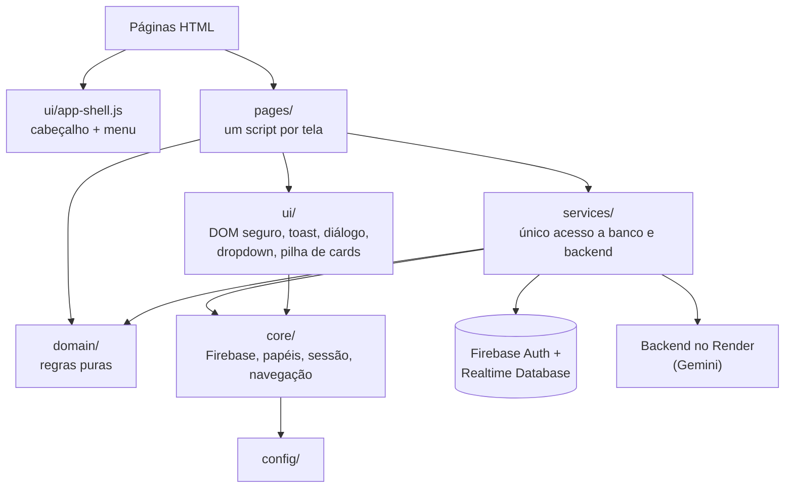

# Arquitetura

O site segue a **arquitetura A — modular em camadas, sem build**: as mesmas tecnologias de antes (HTML, CSS e JavaScript puros, módulos ES, Firebase por CDN), mas com cada responsabilidade em um lugar só.

## Camadas



| Camada | Pode importar | Responsabilidade |
| --- | --- | --- |
| `config/` | só `config/` | ambiente (Emulator × produção), configuração do Firebase, endereço do backend, limites |
| `core/` | `config` | inicializar o Firebase (único arquivo que importa o CDN), papéis, cache da sessão, endereços das páginas |
| `domain/` | nada | regras de negócio puras: revisão espaçada, nomes, perguntas, datas, prompt de tradução |
| `services/` | `core`, `domain`, `config` | ler e gravar no banco; chamar o backend |
| `ui/` | `core`, `domain`, `config` | componentes de interface reutilizáveis |
| `pages/` | todas as anteriores | ligar uma página HTML aos serviços e componentes |

A regra é verificada por script na revisão: nenhuma camada importa uma camada "acima" dela, e só `core/` importa o SDK do Firebase.

Por que assim:

- **`domain/` puro** permite testar a lógica mais delicada (a revisão espaçada) sem navegador nem Firebase.
- **`services/` como porta única** concentra os caminhos do banco: renomear `meetings` para `themes`, por exemplo, muda um arquivo.
- **`ui/app-shell.js`** desenha cabeçalho e menu a partir de uma lista; antes eram 53 linhas copiadas em 6 páginas.

## Ciclo de vida de uma página interna

1. O HTML carrega `js/ui/app-shell.js` primeiro. Ele não depende do Firebase, então cabeçalho e menu aparecem na hora, já com o papel em cache (`sessionStorage`).
2. Depois carrega o script da página (`js/pages/*.page.js`), que chama `initProtectedPage({ allowedRoles })`:
   - espera o Firebase Auth confirmar o usuário (sem sessão → login);
   - confere no banco se a conta não foi excluída e qual é o papel;
   - mostra e-mail e papel no cabeçalho; sem o papel exigido → aviso e volta à home.
3. Só então a página carrega seus dados.

## Modelo de dados

Os nomes dos nós foram mantidos (os dados de produção dependem deles). Repare que `meetings` guarda os **temas** e `meeting_sessions` as **sessões realizadas**.

```
users/{uid}                        firstName, lastName, email, role, planId?, createdAt, updatedAt
deleted_users/{uid}                deletedAt, deletedBy            (lista de bloqueio)
meetings/{temaId}                  topic, questions[], createdAt, updatedAt
meeting_sessions/{sessaoId}        templateId, topic, startedAt, mediatorEmail,
                                   attendees/{uid}: { addedAt }    (sem PII — ADR-004; antigos podem ter name/email)
current_session                    sessionId, topic, startedAt, presenterId, version,
                                   takeoverOf?, live/{presenterId}  (tradutor público; posse por aba — ADR-003)
flashcards/{sessaoId}/{cardId}     front, back, topic, sessionId, createdAt
student_reviews/{uid}/{sessaoId}   stage, lastReviewedAt, stage1CompletedAt...
user_sessions/{uid}/{sessaoId}     { topic, startedAt }            (índice de presença; antigo: true)
plans/{planoId}                    name, price, description?, sessions[{dayOfWeek, startTime, endTime}]  (ADR-005)
weekly_sessions/{AAAA-Www}/{planoId_dia_i}
                                   topicId, topicTitle, questions[], meetLink?, updatedAt  (agenda; ADR-005)
```

## Fluxos principais

**Sessão ao vivo** (`pages/presentation/`): o mediador escolhe um tema (`theme-picker.js`) → "Iniciar" pergunta antes de assumir o tradutor se outra tela estiver no ar, grava a sessão e publica `current_session` por transação com posse desta aba; o `onDisconnect` apaga só a presença desta aba (`live/{presenterId}`), então uma aba antiga não derruba a nova (ADR-003) → os slides (`slides.js`) avançam com setas, espaço ou clique → presença (`attendance.js`) grava na sessão e em `user_sessions` numa escrita atômica → o tradutor (`translator-modal.js`) traduz pelo backend e salva o par como flashcard → "Encerrar" despublica.

**Planos e agenda** (`pages/plans.page.js`, `pages/home.page.js`, ADR-005; vindo do PR #2): o admin cria planos com horários semanais e vincula cada pessoa a um plano em Acessos → a equipe escolhe, para cada horário de cada semana ISO, um tema (título e perguntas copiados) e o link https da chamada → na home, quem tem plano vê "Sua semana" lendo só o próprio plano e os próprios encontros.

**Tradutor público** (`pages/circle-translator.page.js`): observa `current_session` em tempo real (só sessões no ar); traduz sem login. Salvar a tradução como card depende do ambiente (`config/environment.js`): no Emulator não tenta; em produção tenta a escrita direta herdada e, se as regras negarem (a proposta nega escrita anônima), avisa que o card não foi salvo. O destino é o backend controlado descrito em `docs/backend/CONTRATO_BACKEND.md` (não implementado).

**Revisão espaçada** (`domain/srs.js` + `pages/flashcards.page.js`): cada deck tem uma etapa (0 a 3). A etapa 1 libera 24 h depois da sessão; a 2, 7 dias depois de concluir a 1; a 3, 30 dias depois de concluir a 2. Terminar a pilha com a etapa liberada grava o avanço em `student_reviews`.

## CSS

`css/main.css` importa os arquivos **na mesma ordem do antigo `style.css`**, então a cascata não mudou (as capturas de tela da versão antiga e da nova são idênticas, salvo as correções). Ordem: tokens e base → layout → componentes e páginas → `responsive/mobile.css` (sobrescreve o desktop) → `components/late-shared.css` → `overrides/inline-replacements.css`.

O último arquivo reúne as classes que substituíram os antigos atributos `style=`. Ele fica por último de propósito, para manter a precedência que o `style=` tinha.

~~Sem build, cada `@import` é uma requisição a mais no primeiro carregamento.~~ **Desde 20/11/2026** `main.css` é só o
**manifesto**: `npm run css:build` (`scripts/build-css.mjs`) concatena as partes, na mesma ordem e com as `url()` corrigidas,
em `css/app.css`, que é o que as páginas carregam; `npm run css:check` (CI offline) recusa um `app.css` desatualizado e
`verify-static.mjs` recusa página que carregue `main.css`. Medido no perfil móvel: −21 requisições e ~300 ms a menos
até a primeira pintura (`docs/auditorias/CLAUDE_AUDITORIA_DESEMPENHO.md`). Os ícones vêm de `css/components/icons.css`,
gerado por `npm run icons:build` só com os ícones usados (antes: Font Awesome inteiro do cdnjs).

## Limitações conhecidas e próximos passos

1. **Regras do banco** — o código não substitui regras. Proposta pronta em `docs/firebase/database.rules.proposta.json`.
2. **Leitura dos flashcards pelo aluno** — resolvido no código (ADR-004): a tela lê `user_sessions/{uid}` e só os decks das próprias sessões; as regras propostas restringem a leitura por presença. Dados de produção ainda não migrados (plano offline em `scripts/migrations/`).
3. **Contagem de cards na lista de sessões** — `manage-meetings` baixa todos os cards só para contar. Guardar `flashcardCount` na sessão resolve.
4. **Uma sessão pública por vez** — `current_session` continua sendo um nó único, agora com posse por aba, versão e confirmação para assumir (ADR-003): não há mais sobrescrita silenciosa nem queda de aba antiga apagando a nova. Várias sessões simultâneas exigem salas por código (`active_sessions/{codigo}` e `circle-translator.html?sala=...`), plano no mesmo ADR.
5. **Operações privilegiadas no navegador** — criar e excluir contas deveria rodar no backend com o Admin SDK, com papéis em *custom claims*. Enquanto isso, a criação desfaz a conta de login se o perfil falhar (`services/account-creation.js`).
6. **Prompt no navegador** — o backend aceita qualquer prompt. Melhor: rota `/api/translate` que recebe só o texto e monta o prompt no servidor.

### Caminho para a arquitetura B (Vite)

As camadas já estão separadas, então a migração é mecânica: mover `public/js` e `public/css` para `src/`, trocar as URLs do CDN em `core/` por `import ... from 'firebase/...'` (npm), ler `config/` de `import.meta.env`, transformar `ui/app-shell.js` em partials de HTML e ligar ESLint, Vitest e CI. O código de `domain/` e `services/` não muda.
