# Diagramas técnicos — FluenCircle

**Revisão:** 20/11/2026, Claude (Issue #41), sobre `main` `0e27c9a` + branch `audit/claude-security-performance-architecture`.
Cada ligação foi conferida no código citado abaixo de cada diagrama. Sintaxe validada com o parser oficial do Mermaid
(ver "Validação" no fim).

- **AS-IS** = comportamento implementado e verificado no código desta branch.
- **TO-BE** = proposta, **não implementada**. Nenhum TO-BE descreve algo que já exista.
- **PR #40** = trabalho do Codex ainda **não integrado** (salas ao vivo só no Emulator); aparece marcado como tal.
- Nada aqui descreve as regras **ativas** em produção (desconhecidas — SEC-02).

Índice: [1 Contexto](#1--contexto-c4-nível-1-as-is) · [2 Contêineres](#2--contêineres-c4-nível-2-as-is) ·
[3 Componentes](#3--componentes-do-frontend-as-is) · [4 Autenticação](#4--autenticação-e-autorização-as-is) ·
[5 Sessão](#5--início-e-encerramento-de-sessão-as-is) · [6 Concorrência](#6--concorrência-entre-mediadores-as-is-adr-003) ·
[7 Tradutor](#7--tradutor-e-flashcards-as-is-e-to-be) · [8 Planos](#8--criação-e-gestão-de-planos-as-is) ·
[9 Agenda](#9--agendamento-semanal-as-is) · [10 Dados](#10--modelo-de-dados-do-realtime-database-as-is) ·
[11 Erros](#11--estados-de-erro-e-reconexão-as-is) · [12 Implantação](#12--implantação-e-ambientes-as-is-e-to-be) ·
[13 Dependências](#13--dependências-externas-as-is) · [14 Recuperação](#14--recuperação-backup-e-rollback-to-be)

## 1 — Contexto (C4 nível 1, AS-IS)

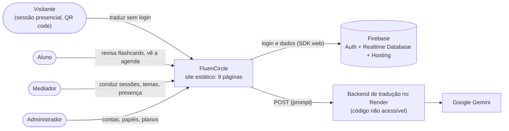

**Código:** `public/*.html`, `public/js/core/firebase*.js`, `public/js/services/translate.service.js`.

## 2 — Contêineres (C4 nível 2, AS-IS)

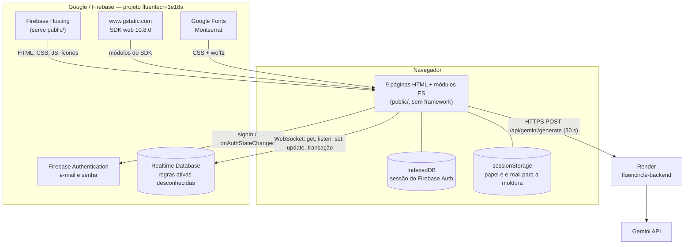

**Código:** `public/js/config/firebase.config.js`, `core/firebase.js`, `core/firebase-auth.js`, `core/session-cache.js`,
`config/app.config.js` (`TRANSLATE_TIMEOUT_MS`). Ícones e CSS são servidos pelo próprio site desde `2263bfb`/`76a0e23`.

## 3 — Componentes do frontend (AS-IS)

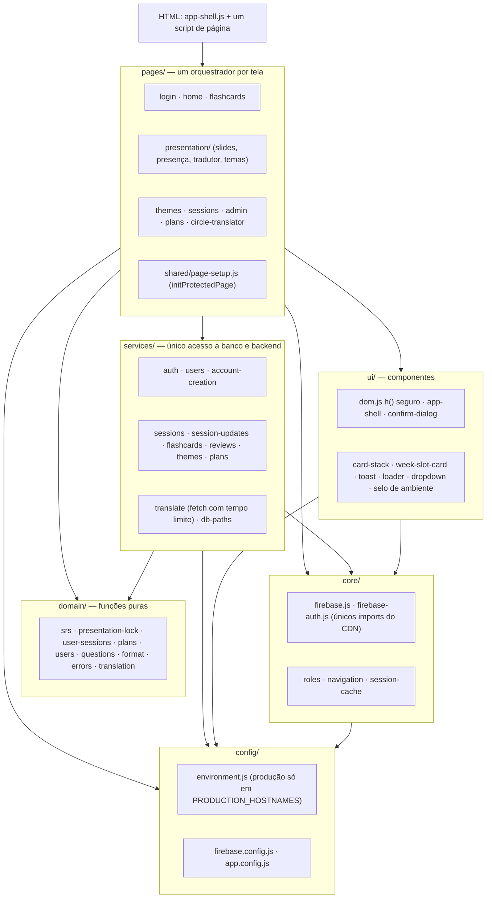

**Verificado pela CI:** `scripts/architecture-rules.mjs` impõe exatamente estas setas (e nenhuma outra), ausência de
ciclos e de DOM em `domain/`, `services/` e `config/` — 52 módulos e 153 imports na `main` (EXECUTADO).

## 4 — Autenticação e autorização (AS-IS)

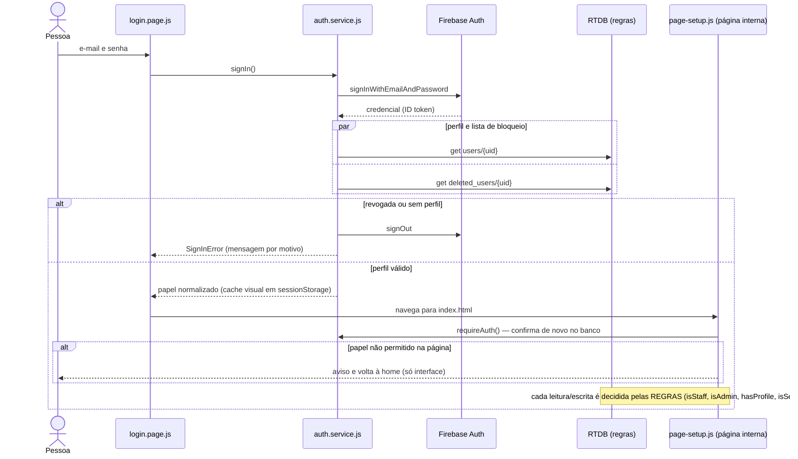

**Código:** `services/auth.service.js` 49–133, `pages/shared/page-setup.js`, `firebase/rules/database.rules.source.mjs` 29–52.
Esconder botões por papel é conveniência; a barreira real são as regras (proposta testada; ativas desconhecidas).

## 5 — Início e encerramento de sessão (AS-IS)

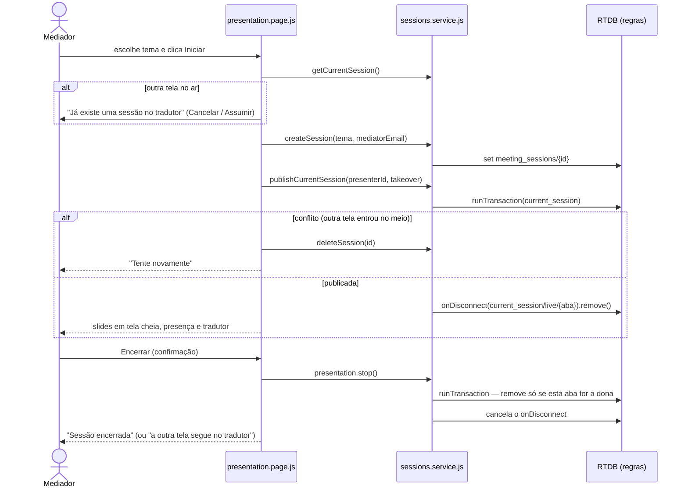

**Código:** `pages/presentation/presentation.page.js` 115–192, `services/sessions.service.js` 77–157,
`domain/presentation-lock.js`. Falha ao encerrar mantém a sessão na tela (não vira sucesso falso).

## 6 — Concorrência entre mediadores (AS-IS, ADR-003)

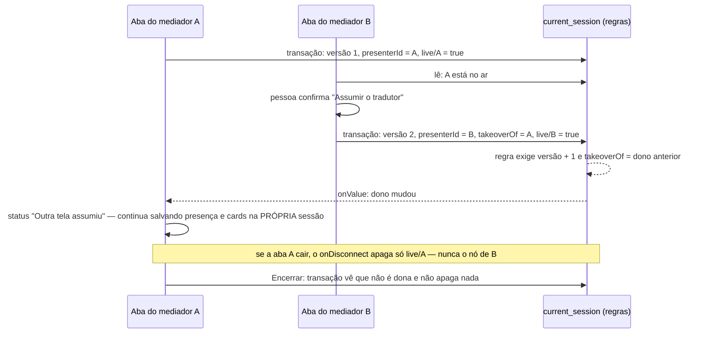

**Código e testes:** `domain/presentation-lock.js` (`planPublish`, `planUnpublish`, `planReconnect`),
`tests/rules/sessao-ativa.rules.test.mjs` (Emulator oficial, EXECUTADO), `tests/e2e/concorrencia.e2e.test.mjs`.

## 7 — Tradutor e flashcards (AS-IS e TO-BE)

### 7a — AS-IS

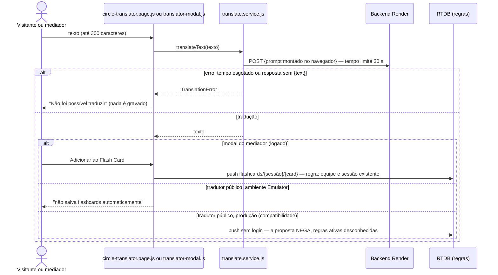

### 7b — TO-BE: backend controlado (não implementado)

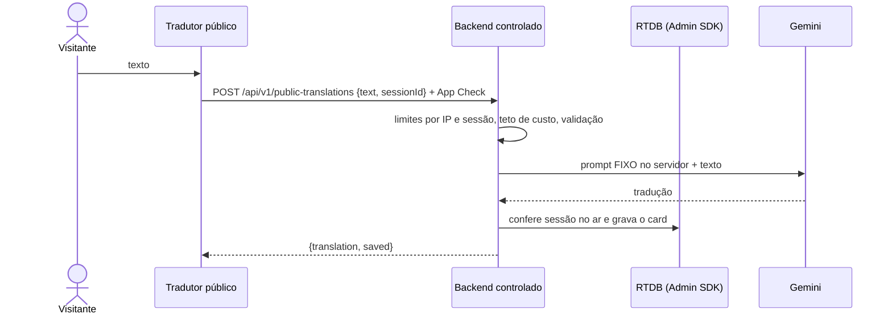

**Código:** `services/translate.service.js`, `pages/circle-translator.page.js`, `pages/presentation/translator-modal.js`,
`config/environment.js` (`publicTranslatorSavesFlashcards`). Contrato TO-BE: `docs/backend/CONTRATO_BACKEND.md`.

## 8 — Criação e gestão de planos (AS-IS)

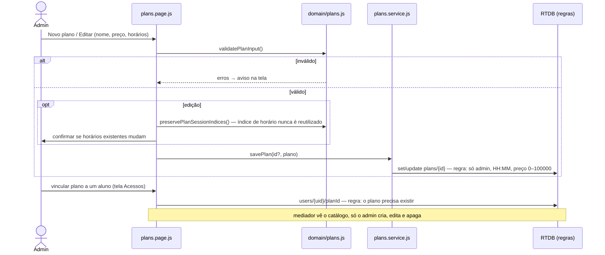

**Código:** `pages/plans.page.js` 238–310, `pages/admin.page.js`, `domain/plans.js` 147–258,
`services/plans.service.js`, regras `plans` e `users/$uid/planId`. Excluir um plano não apaga vínculos nem encontros (a
tela de Acessos mostra "Plano removido").

## 9 — Agendamento semanal (AS-IS)

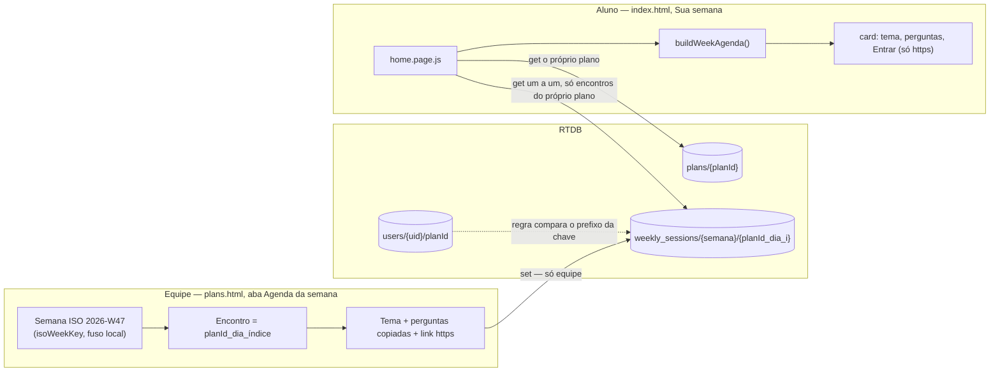

**Código:** `domain/plans.js` (`isoWeekKey`, `slotKey`, `buildWeekAgenda`, `isSafeMeetLink`), `pages/plans.page.js`
84–173, `pages/home.page.js`, `services/plans.service.js` 57–92, regra `weekly_sessions/$week/$slot/.read`.

## 10 — Modelo de dados do Realtime Database (AS-IS)

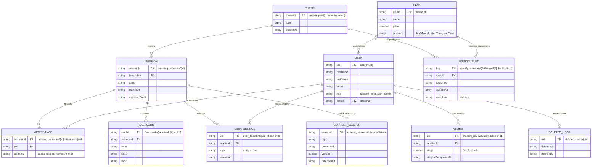

**Observações:** o RTDB é uma árvore JSON, não relacional. `CURRENT_SESSION` também guarda `startedAt` e
`live/{presenterId}`. O PR #40 (não integrado) acrescenta `live_rooms/{sessionId}`, `live_room_members/{sessionId}/{uid}`
e `live_room_chat/{sessionId}/{msg}` — ver `CLAUDE_AUDITORIA_SEGURANCA.md` §4. **Fonte:** `services/db-paths.js` e
`firebase/rules/database.rules.source.mjs`.

## 11 — Estados de erro e reconexão (AS-IS)

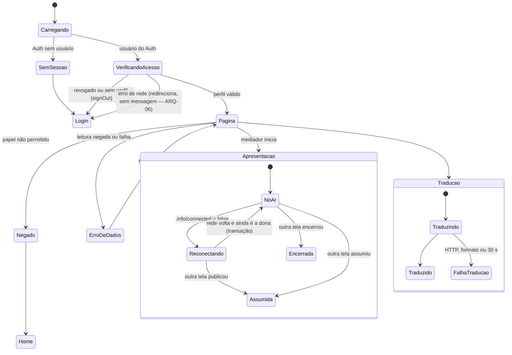

**Código:** `services/auth.service.js` `requireAuth`/`resolveAccess`, `pages/shared/page-setup.js`,
`services/sessions.service.js` `watchPresentation` 97–157, `services/translate.service.js`.

## 12 — Implantação e ambientes (AS-IS e TO-BE)

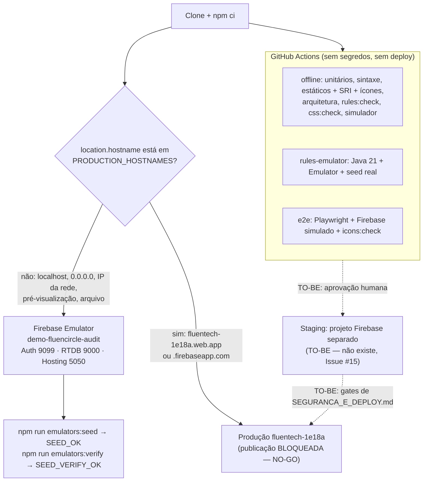

**Código:** `config/environment.js`, `config/firebase.config.js`, `firebase.emulator.json`, `.github/workflows/ci.yml`.
Não existe `firebase.json` na raiz de propósito (deploy acidental impossível); o do Hosting real nunca foi versionado.

## 13 — Dependências externas (AS-IS)

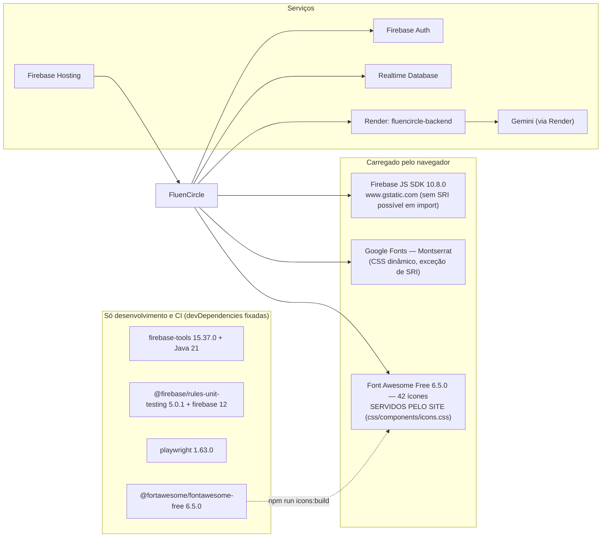

**Fonte:** `docs/operacao/DEPENDENCIAS.md`. `npm audit` (20/11/2026): 19 avisos, todos em dependências de teste (SEC-16).

## 14 — Recuperação, backup e rollback (TO-BE)

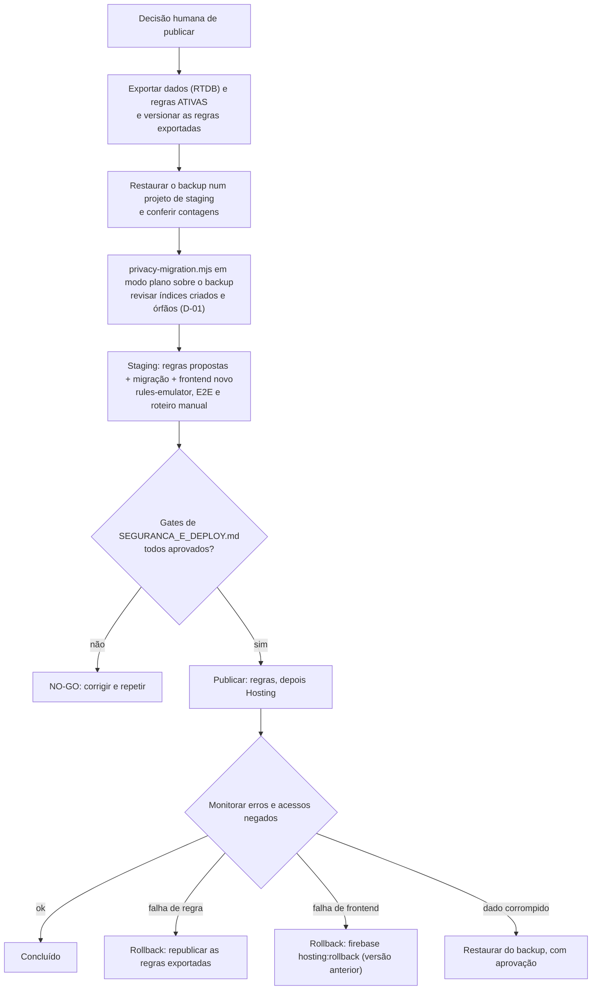

**Fonte:** `docs/operacao/BACKUP_E_ROLLBACK.md`, `docs/operacao/SEGURANCA_E_DEPLOY.md`. **Nada disso foi executado**: não há
staging nem acesso a produção nesta auditoria.

## Diagramas complementares

### C1 — Revisão espaçada (AS-IS)

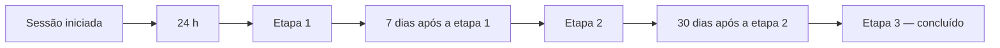

`domain/srs.js`. A regra aceita só +1 etapa por vez com carimbo ISO; o prazo não é verificável nas regras (SEC-15).

### C2 — Leitura mínima do aluno (AS-IS, ADR-004)

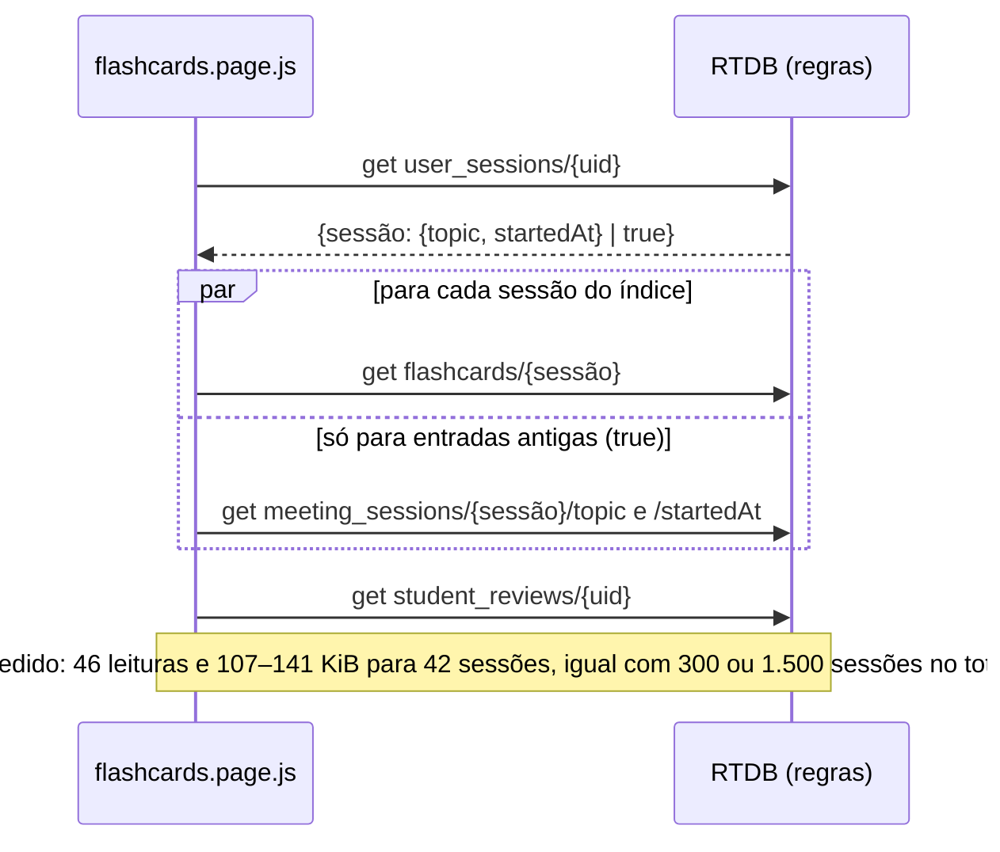

### C3 — Leitura da equipe hoje × paginada (AS-IS e TO-BE)

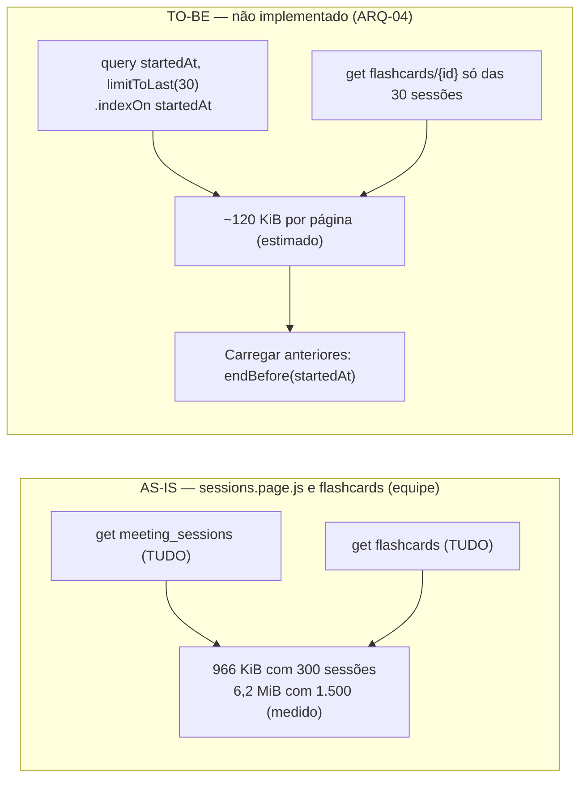

### C4 — Salas ao vivo (PR #40, NÃO integrado; só no Emulator)

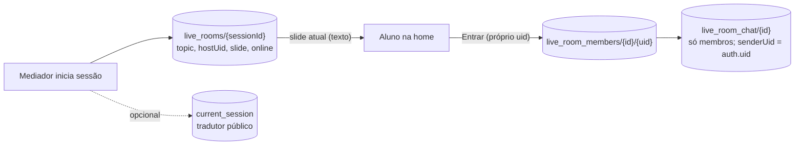

Voz (WebRTC), "Fluêncio" e entrada com presença acadêmica, que existiam em `3c6e7f0`, **não** fazem parte do PR #40.

## Validação

- [x] Sintaxe de todos os blocos conferida com `mermaid.parse()` e `mermaid.render()` (Mermaid 11.17.2) no Chromium do Playwright, em 20/11/2026: 19/19 blocos.
- [x] Cada diagrama AS-IS cita os arquivos de onde as ligações foram conferidas.
- [ ] Atores, permissões e fluxos confirmados pelo responsável humano.
- [ ] Atualizar sempre que mudar esquema, endpoint, fluxo, papel ou ambiente.
